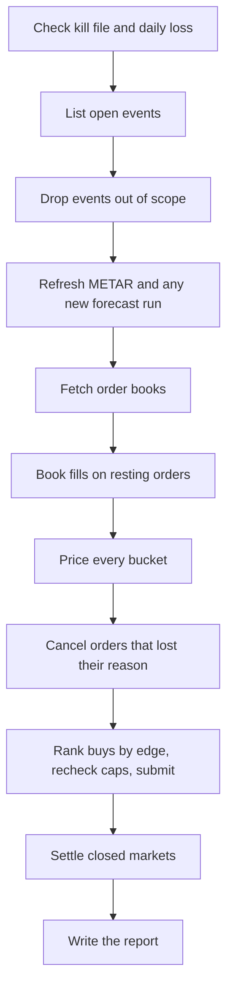

# Architecture

How the code fits together. For setup and commands see the [README](../README.md). For the pricing maths see [model.md](model.md).

## Layout

Everything lives in `src/weatherbot/`, and each module has one job.

| Module | Job |
| --- | --- |
| `cli.py` | Commands, exit codes and the run lock. The only place that builds an executor |
| `config.py` | Loads `config.yaml`, rejecting unknown keys and out-of-range numbers |
| `core.py` | Shared types: `Rule`, `Bucket`, `Market`, `Event`, `Book` |
| `rules.py` | Turns raw venue events into typed events, or refuses them with a reason code. Reads station, unit, rule family and buckets from each market's own text |
| `venues/intl.py` | polymarket.com data: Gamma for events, CLOB for books |
| `venues/us.py` | Polymarket US public data, from its retail gateway |
| `aviation.py` | METAR client for the Aviation Weather Center |
| `metar.py` | Parses reports and works out the qualifying high under each rule |
| `openmeteo.py` | Open-Meteo client and the compact form forecast runs are stored in |
| `forecast.py` | Fetches a run only when a model publishes a new one, and pools the members |
| `timeutil.py` | Day windows under each clock, half-up rounding, unit conversion |
| `model.py` | Turns members and observations into bucket probabilities |
| `fees.py` | Taker fee schedule, read per market |
| `strategy.py` | Picks the side, order style and size, or says why not |
| `engine.py` | One trading cycle |
| `executors.py` | Paper fills |
| `live.py` | Live gates, the signed client, the fail-closed executor and the kill switch |
| `ledger.py` | SQLite storage for all of the above |
| `settle.py` | Books resolved markets and audits each result against our reading of the rules |
| `report.py` | P&L, Brier score, calibration chart and health |
| `backtest.py` | Replays closed markets through `engine.py` |
| `http.py` | JSON client with retries. Every API call goes through it, and the live order client runs it with retries off |

Files the bot writes:

| Path | Holds |
| --- | --- |
| `data/weatherbot.sqlite` | The ledger, for paper and live |
| `data/backtest.sqlite` | The replay's own ledger |
| `data/run.lock` | The overlap guard |
| `data/run.log` | launchd or cron output |
| `data/KILL` | The kill switch, when it's on |
| `reports/` | Reports and charts, rebuilt on every run |

## One run

`weatherbot run` loads the config, takes the run lock, and then does three passes over the venues: trade, settle, report. A failure on one venue doesn't stop the others, and a failed trade pass doesn't stop settlement or the report. The exit code still shows it.



The trade pass is `engine._cycle`:

1. **Stops.** `executor.check_stops` runs before any market data, so an outage can't hold a stop back. Paper has no stops.
2. **Listing.** `venue.open_events` returns typed events plus counts of what it couldn't parse. `_in_scope` then drops events with no configured station (`station_not_configured`), too far ahead (`beyond_lead_limit`), or whose settlement day has ended (`day_over`).
3. **Observations.** Stations more than 2 hours behind get a long backfill. The rest get a short recent fetch.
4. **Forecasts.** `Forecasts.refresh` compares each model's latest run with what the ledger holds and fetches only what's new. A 429 stops the round.
5. **Books.** `venue.books`, then `executor.sync` books any fills on resting orders.
6. **Pricing.** `_price_event` reads reports stamped at or before `now`, bias-corrects each model, works out any hold reason, and calls `price_day` and `bucket_probabilities`. Every book it sees is saved.
7. **Order care.** `_manage_orders` cancels a resting order if its market can't be priced (`cannot_price`), the signal changed (`signal_gone`), or it has reached its TTL (`ttl`). A TTL cancel lets that market cross the spread this cycle, unless the cancel is still pending, since crossing then could buy twice.
8. **Decisions.** `_decide` evaluates every market with no exposure, ranks the buys by edge, then re-evaluates each one against real exposure, so the best edge gets first call on the caps. Holds and skips are logged too, which is how `warming_up` markets still get scored.

### How the bias record builds

The correction needs a forecast and an outcome for the same day, and they arrive at different times:

1. While pricing, `_corrected` logs each model's raw mean high to `forecast_log`. Only the first forecast seen at each lead is kept, so a later, better run can't flatter the record.
2. After a day settles, `settle._audit` works out the observed high and stores it in `daily_highs`, unless a hole in the reports means it could read low.
3. `Ledger.bias` joins the two. See [model.md](model.md#3-bias-correction).

The same data serves paper and live, so correction carries straight into live mode.

## The ledger

SQLite in WAL mode. All times are Unix seconds, and prices run from 0 to 1.

| Table | Holds |
| --- | --- |
| `runs` | One row per venue per run: status, counts, skip reasons, error |
| `events`, `markets` | What was listed, the parsed rule, the fee schedule, and the settlement result |
| `books` | Book snapshots, top 10 levels, compressed and deduplicated by hash |
| `decisions` | Model probability and band, price, edge, action, reason, order details, book id, forecast run times, floor, lead |
| `decision_state` | The last logged state per market. A market is logged again only when that changes, or when it buys |
| `orders`, `fills` | Paper and live orders, told apart by `orders.mode`, and their fills |
| `forecast_snapshots` | Every ensemble run fetched, compressed. Open-Meteo keeps no past ensembles, so this is the only archive |
| `metar_obs` | Raw reports with parsed temperature and maximum groups |
| `station_state` | When each station was last fetched |
| `forecast_log` | First forecast seen per station, day, policy, lead and model |
| `daily_highs` | Observed highs that are safe to learn from |
| `rule_audit` | Our predicted winner against the real one |
| `day_equity` | First live equity reading of each UTC day, for the loss limit |
| `price_history`, `replay_outcomes` | Used only by the backtest |

Useful queries:

```sql
-- Why markets were skipped lately
SELECT reason, COUNT(*) FROM decisions
WHERE action = 'skip' GROUP BY reason ORDER BY 2 DESC;

-- Failed runs
SELECT datetime(started_at, 'unixepoch'), venue, error FROM runs WHERE status != 'ok';

-- Markets where our reading of the result disagreed with the outcome
SELECT venue, station, day, degree, expected_market, actual_market
FROM rule_audit WHERE agrees = 0;
```

## Rules worth keeping

These are what make the results mean anything. Changing one needs a good reason.

- **Nothing reads the future.** The engine sees only reports stamped by `now` and forecast runs fetched by `now`. In a replay, each run stays hidden until 11 hours after its start.
- **One code path.** The backtest runs the real `run_cycle`, with only the venue and data sources swapped.
- **Markets name their own station and rule.** Nothing is hardcoded by city. A market that can't be read is refused with a reason.
- **Weather maths stays in Celsius.** Only the final bucket comparison uses the market's unit, so rounding matches settlement.
- **Trades use the conservative probability.** Decisions run on the band's worse side, and the point estimate is only for scoring.
- **A held quote is still scored.** Warm-up and thin data stop trades, not measurement.
- **Live fails closed.** Orders are never retried. Only an HTTP 400 is a clean rejection, and anything else trips the kill switch.
- **Scheduled files stay paper-only.** `tests/test_deploy.py` fails if `--live` appears in `deploy/`.
- **No VPN or proxy path.** Geoblocks are respected, not routed around.

## Extending it

**A station.** Add a line under `stations:` in `config.yaml` with its ICAO, time zone, coordinates and elevation. `station_not_configured` under Health in the report shows what's missing. It then starts its own warm-up.

**A forecast model.** Add it to `MODELS` in `config.py`, `_META_PATHS` in `openmeteo.py` and `forecast.models` in `config.yaml`. Every configured model needs its own record, so trades pause until the new one has one.

**A resolution rule.** Teach `rules.py` to recognise the source, and `metar.py` which readings count. Then watch the rule audit, which is the check that the reading is right.

**A venue.** Write a class with `name`, `open_events(now)`, `books(markets)` and `outcomes(event_id, market_ids)`. The backtest also needs `closed_events(since)` and `quote_history(market, start, end)`. Register it in `cli._venue` and `config.VENUES`, and use `venues.parse_all` so one bad listing costs only itself.

## Tests

```bash
uv run pytest
```

There is one test file per module. Responses in `tests/fixtures/` were recorded from the real APIs, and HTTP is mocked with `respx`, so no network or keys are needed. Warnings count as failures.

Live code is tested against fakes built from the API docs. Treat those fakes as a description of the docs, not of the exchange.

New behaviour should come with a test that fails first. A test only counts if it fails when the behaviour breaks, so when a rule matters, break it on purpose and see that a test notices.
