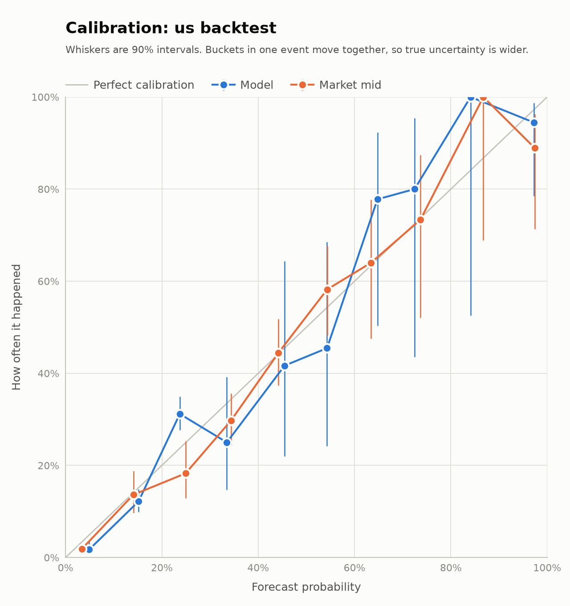
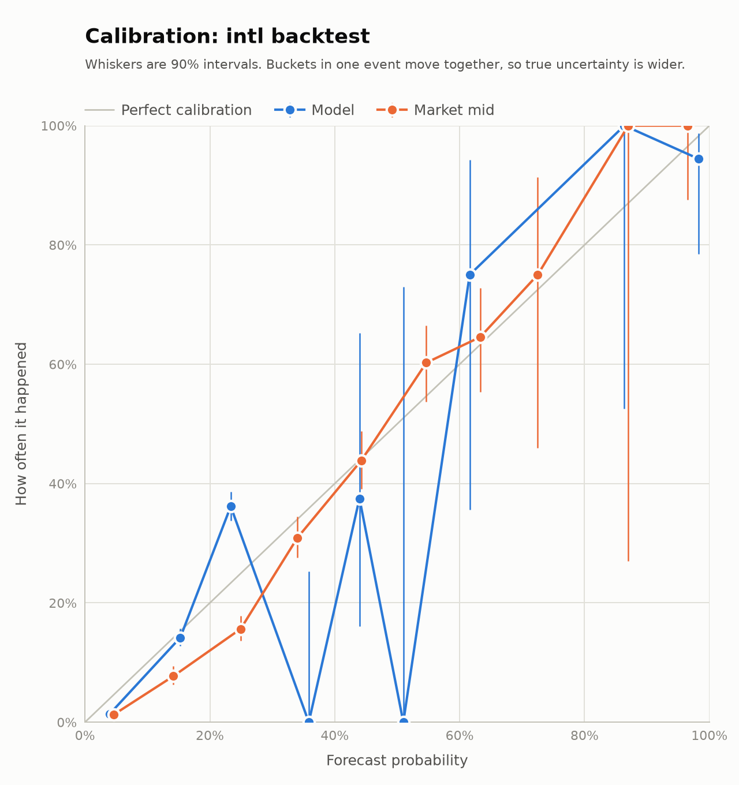

# Results

A snapshot from October 31, 2026, not a live record. The bot writes its current numbers to `reports/` on every run.

## Where things stand

- **Paper trading hasn't started.** A real test cycle on October 31 listed 14 `us` and 135 `intl` events with no errors and placed no orders, because a new ledger starts in [warm-up](../README.md#warm-up).
- **There is no evidence of an edge.** Over a 21-day replay the model scored worse than the market's own prices, and both P&L intervals include zero.
- **The replay can't measure the edge anyway.** It uses stand-in forecasts and assumed depth. See [Backtest](../README.md#backtest) for why. Only paper trading can answer the question.

## Replay, October 10–30, 2026

Run on the final model code with `weatherbot backtest --days 21`, taking liquidity only, starting from $1,000 on each venue.

| | `us` | `intl` |
| --- | --- | --- |
| Stations | 6 | 11, all in the US |
| Events replayed | 115 of 119 closed (4 unresolved) | 215, of which 214 settled |
| Fills, all settled | 309 | 106 |
| Realized P&L | −$33.55 | −$107.40 |
| 90% interval, resampling days | −$250.79 to +$207.17 | −$248.19 to +$35.88 |
| Fees paid | $44.23 | $6.13 |
| Win rate by position | 29% | 41% |
| Max drawdown by event day | $114.05 | $111.66 |
| Average edge at entry | +17.6¢ | +26.3¢ |
| Realized edge after fees | −0.8¢ | −6.9¢ |
| P&L if every fill paid 0.05 × p × (1−p) | −$21.14 | −$118.36 |

The gap between the edge at entry and the edge realized is the main finding: much of the claimed edge isn't real. On `us`, the 0.05 line is better than the actual result because that venue's real fee is higher.

### Model against market

Brier score, lower is better. Each pair compares the model with the market mid at the same moment. Lead means hours until the settlement day ends, so 0–6h is the last part of the day itself.

| Set | `us` model | `us` market | `intl` model | `intl` market |
| --- | --- | --- | --- | --- |
| All buckets | 0.1249 | **0.1036** | 0.1057 | **0.0950** |
| Market mid 5–95% | 0.1925 | **0.1653** | 0.1331 | **0.1218** |
| 0–6h | **0.0681** | 0.0866 | **0.0152** | 0.0214 |
| 6–24h | 0.1300 | **0.0959** | 0.1509 | **0.1134** |
| 24–48h | 0.1241 | **0.1117** | 0.1356 | **0.1091** |
| 48h+ | | | **0.0717** | 0.0807 |

The 90% interval on model minus market, resampling days, is +0.0147 to +0.0281 on `us` and +0.0076 to +0.0140 on `intl`. Both sit wholly above zero, so the market was the better forecaster overall.

The model won only in the last 6 hours, on small samples (45 and 39 forecasts), and on `intl` two days out.

### P&L by lead

| Lead | `us` fills | `us` P&L | `intl` fills | `intl` P&L |
| --- | --- | --- | --- | --- |
| 0–6h | 1 | +$2.28 | | |
| 6–24h | 25 | +$52.84 | 24 | −$24.60 |
| 24–48h | 283 | −$88.67 | 49 | −$45.13 |
| 48h+ | | | 33 | −$37.67 |

Don't read the +$52.84 as a signal. It's 25 fills, and the interval on the whole run covers it many times over.

Most of the 24–48h loss is an artefact. The stand-in kernel is 1.5°C wide, which caps the model at about 0.28 on a 2°F bucket, so it keeps betting against favourites the market has right.

### Near-certain prices

Every logged decision with a model probability of 0.9 or more, by hours left in the settlement day. These counts come from the replay ledgers, not the report, whose calibration table samples fewer quotes.

| Hours left | `us` decisions | `us` events | `us` hit | `intl` decisions | `intl` events | `intl` hit |
| --- | --- | --- | --- | --- | --- | --- |
| 0–3 | 15 | 15 | 100% | 52 | 52 | 100% |
| 3–6 | 108 | 108 | 99.1% | 211 | 211 | 99.1% |
| 6–9 | 53 | 53 | 98.1% | 201 | 201 | 98.0% |
| 9–12 | 25 | 25 | 100% | 42 | 42 | 88.1% |
| 12–18 | 9 | 5 | 100% | 10 | 6 | 80.0% |
| 18–24 | 6 | 3 | 100% | 7 | 4 | 71.4% |
| 24+ | 13 | 2 | 100% | | | |

Past 12 hours these rest on a handful of events, so they say little either way.

Before the sensor-gap and opening fixes, `us` hit 84.3% at 6–9 hours and 87.8% at 9–12. The `intl` misses at 12–24 hours and one miss at 9–12 are a single event, KORD on October 16, under `noaa_timeseries`, a rule open markets no longer use. The remaining 9–12 hour `intl` figure still runs a little overconfident, which is left for paper trading to measure.

### Rule audit

Whether our reading of the observations picked the bucket that really won. This is the strongest result here, because it doesn't depend on the forecast.

| Rule family | Checked | Agreed |
| --- | --- | --- |
| `nws_cli` | 115 | 114 |
| `metar_routine` | 84 | 84 |
| `noaa_timeseries` | 130 | 129 |

### Calibration

Blue is the model, orange the market. The diagonal is perfect calibration. The model's cluster around 20–30% is the kernel cap at work.

| `us` | `intl` |
| --- | --- |
|  |  |

Full reports, with station breakdowns and calibration tables:

- [`us` report](results/report-us-backtest.md)
- [`intl` report](results/report-intl-backtest.md)

## Reproducing this

```bash
.venv/bin/weatherbot backtest --days 21 --venue us
```

Numbers will differ, because the window ends today and METAR history stops after about 30 days. October 2026 can't be replayed exactly later on.

## What would count as evidence

From [Going live](../README.md#going-live): positive P&L after fees across many settled days, an interval clear of zero, and a model Brier score below the market's. All three, on paper, with real ensembles and real books.
