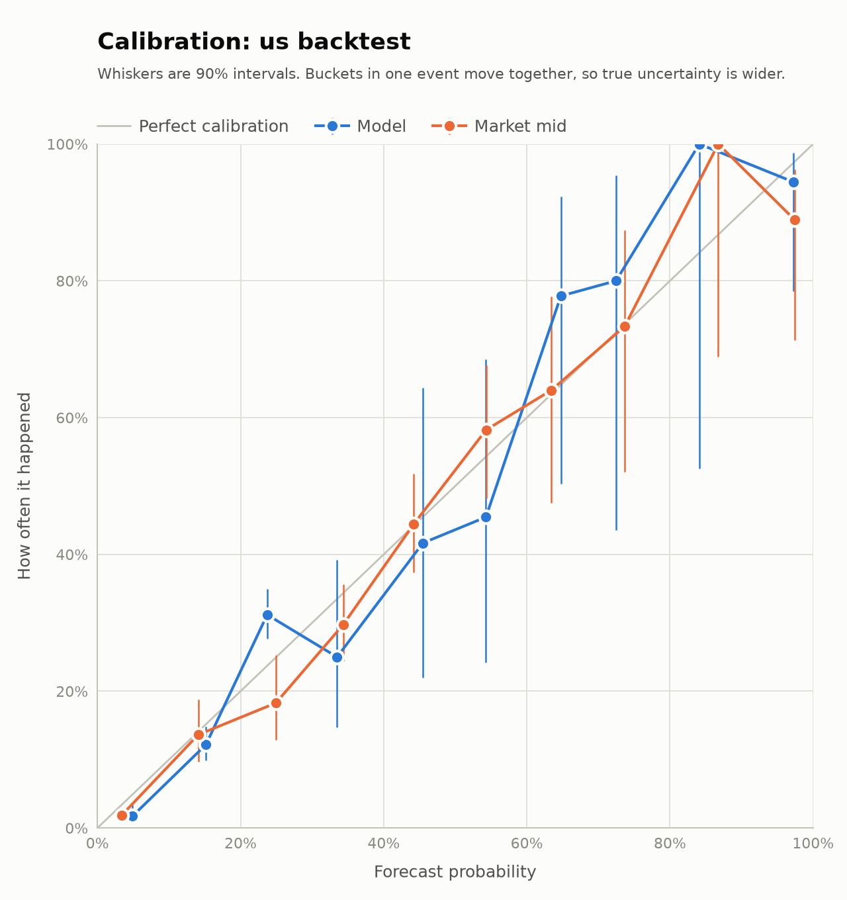

# us backtest report

Generated 2026-10-31 07:57 UTC.

**Not a measure of the edge.** Open-Meteo doesn't archive ensemble members, so a few deterministic models stand in for the ensemble the bot trades on. Book depth is assumed, polymarket.com quotes are one price with an assumed spread, and settlement timing is approximate. Use this to check the pipeline. Only paper trading measures the edge.

## P&L

| Measure | Value |
| --- | --- |
| Starting bankroll | $1,000.00 |
| Realized P&L | -$33.55 |
| Unrealized P&L (at mid) | +$0.00 |
| Equity | $966.45 |
| Cost of open positions | $0.00 |
| Fees paid | $44.23 |
| Realized P&L if every fill paid 0.05 x p x (1-p) | -$21.14 |
| Fills, of which settled | 309, 309 |
| Win rate by position | 29% |
| Max drawdown by event day | $114.05 |
| 90% interval on realized P&L, resampling days | -$250.79 to +$207.17 |
| Average edge at entry, per share | +17.6c |
| Realized edge after fees, per share | -0.8c |

### Settled P&L by station

| Station | Fills | P&L |
| --- | --- | --- |
| KSFO | 57 | +$46.16 |
| KLAX | 55 | +$21.56 |
| KMIA | 62 | +$6.21 |
| KPHL | 25 | -$28.75 |
| KMDW | 64 | -$36.87 |
| KNYC | 46 | -$41.86 |

### Settled P&L by lead time

| Lead time | Fills | P&L |
| --- | --- | --- |
| 6-24h | 25 | +$52.84 |
| 0-6h | 1 | +$2.28 |
| 24-48h | 283 | -$88.67 |

### Settled P&L by side

| Side | Fills | P&L |
| --- | --- | --- |
| yes | 151 | -$15.35 |
| no | 158 | -$18.20 |

### Settled P&L by order style

| Order style | Fills | P&L |
| --- | --- | --- |
| taker | 309 | -$33.55 |

## Brier score

Lower is better. Each row pairs the model with the market mid at the same moment.

| Set | Forecasts | Model | Market |
| --- | --- | --- | --- |
| All buckets | 1340 | 0.1249 | 0.1036 |
| Market mid 5-95% | 815 | 0.1925 | 0.1653 |
| 0-6h | 45 | 0.0681 | 0.0866 |
| 24-48h | 678 | 0.1241 | 0.1117 |
| 6-24h | 617 | 0.1300 | 0.0959 |

Model minus market, 90% interval resampling days: +0.0147 to +0.0281.
An interval wholly below zero favours the model.

## Calibration

### Model

| Bin | Forecasts | Mean forecast | Happened | 90% interval |
| --- | --- | --- | --- | --- |
| 0%-10% | 341 | 4.9% | 1.8% | 0.9%-3.4% |
| 10%-20% | 476 | 15.2% | 12.2% | 9.9%-14.9% |
| 20%-30% | 433 | 23.7% | 31.2% | 27.6%-34.9% |
| 30%-40% | 32 | 33.5% | 25.0% | 14.7%-39.2% |
| 40%-50% | 12 | 45.5% | 41.7% | 22.0%-64.4% |
| 50%-60% | 11 | 54.3% | 45.5% | 24.2%-68.5% |
| 60%-70% | 9 | 64.8% | 77.8% | 50.4%-92.4% |
| 70%-80% | 5 | 72.5% | 80.0% | 43.5%-95.4% |
| 80%-90% | 3 | 84.1% | 100.0% | 52.6%-100.0% |
| 90%-100% | 18 | 97.3% | 94.4% | 78.5%-98.8% |

### Market mid

| Bin | Forecasts | Mean forecast | Happened | 90% interval |
| --- | --- | --- | --- | --- |
| 0%-10% | 650 | 3.4% | 1.8% | 1.2%-2.9% |
| 10%-20% | 154 | 14.1% | 13.6% | 9.7%-18.8% |
| 20%-30% | 104 | 24.9% | 18.3% | 12.9%-25.3% |
| 30%-40% | 175 | 34.3% | 29.7% | 24.4%-35.7% |
| 40%-50% | 126 | 44.2% | 44.4% | 37.4%-51.8% |
| 50%-60% | 67 | 54.3% | 58.2% | 48.2%-67.6% |
| 60%-70% | 25 | 63.4% | 64.0% | 47.6%-77.7% |
| 70%-80% | 15 | 73.7% | 73.3% | 52.1%-87.4% |
| 80%-90% | 6 | 86.8% | 100.0% | 68.9%-100.0% |
| 90%-100% | 18 | 97.4% | 88.9% | 71.4%-96.3% |

## Rule audit

Our own reading of each result, against the bucket that actually won.

| Rule family | Checked | Agreed | Share | No verdict |
| --- | --- | --- | --- | --- |
| nws_cli | 115 | 114 | 99% | 0 |

## Health

195 cycles, 0 failed.

| Skip reason | Events |
| --- | --- |
| beyond_lead_limit | 10230 |
| day_over | 9435 |
| warming_up | 1173 |
